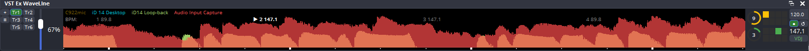
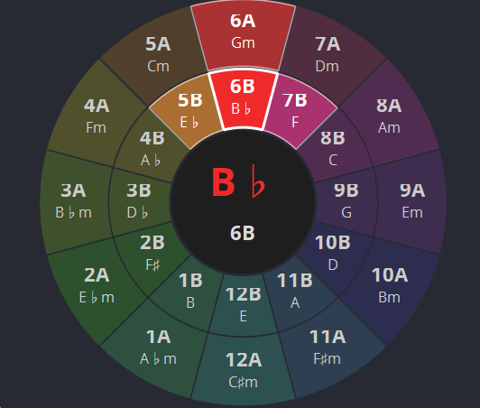

[English](README.md) | [日本語](README.ja.md) | **한국어** | [Bahasa Indonesia](README.id.md) | [Français](README.fr.md) | [繁體中文](README.zh-TW.md)

# VST Ex Audio Filter for OBS

OBS Studio용 확장 오디오 필터 창입니다. 노래 방송을 위한 즉시 ON/OFF 전환, 지연 측정, 체인 보기를 갖추고,
자체 **VST2 / VST3** 호스트 **VST Enigmax Loader**가 함께 제공됩니다. "필터 (VST Ex)" 창은 OBS 기본 "필터" 창과
같은 필터 체인을 다루므로 어느 쪽에서든 조작할 수 있습니다.

OBS 플러그인 2개가 설치됩니다: **VST Ex** (창, 도크, 내장 필터)와 **VST Enigmax Loader** (VST 호스트).
VST 필터는 VST Enigmax Loader 소속이므로, 이것을 제거하면 OBS가 그 필터를 불러올 수 없습니다.
제거하기 전에 VST2 필터는 "인계" (아래)로 OBS 기본 VST 2.x 필터로 옮기세요.

- Windows x64, OBS Studio 31 이상 (33.0에서 확인)
- 제작자: ChromeBread feat. BlackDream · 라이선스: GPL-2.0

## 설치

1. [Releases](../../releases)에서 `OBS-VST-Ex-Audio-Filter-<버전>-windows-x64-setup.exe`를 다운로드합니다.
2. OBS를 종료하고 실행합니다. "전체 설치"는 모두, "사용자 지정 설치"는 다음 중에서 고를 수 있습니다:
   - VST Ex Audio Filter (필수): "필터 (VST Ex)", 피치 / 의사 스테레오 필터, 도구 > #cbOBScripts > VST Ex Audio Filter
   - VST Enigmax Loader: VST2 / VST3 플러그인
   - VST Ex Chain View, VST Ex Mixer 도크, VST Ex Switcher 도크, VST Ex WaveLine 도크

   VST Ex의 선택 항목은 나중에 도구 > #cbOBScripts > VST Ex Audio Filter에서 켜고 끌 수 있습니다 (OBS 재시작 후 적용).
3. OBS를 시작합니다. 처음 시작할 때 썸네일, 스크린샷, 기록을 저장할 곳을 묻습니다.

**설치 없는 버전**: `OBS-VST-Ex-Audio-Filter-<버전>-windows-x64-portable.zip`. OBS를 종료하고
`C:\ProgramData\obs-studio\plugins\`에 압축을 풀면 `OBS-VST-Ex-Audio-Filter` (VST Ex)와 `vst-enigmax-loader`
(VST Enigmax Loader) 두 폴더가 생깁니다. 필요 없는 폴더는 넣지 않아도 됩니다. 제거는 OBS를 종료하고 폴더를 지우면
됩니다 (VST 필터는 먼저 인계하세요. 아래 참조).
백업과 함께 제거하려면 `OBS-VST-Ex-Audio-Filter\Safe_Uninstaller\Safe_Uninstaller.bat`을 실행하세요.

**제거** (Windows 설정 > 앱 > VST Ex Audio Filter for OBS). 제거 프로그램은:
1. 장면 모음에 VST Enigmax Loader 필터가 남아 있으면 경고하여 먼저 인계할 수 있게 합니다
2. 플러그인 썸네일, 고해상도 스크린샷, 설정 / 프리셋 / 기록을 삭제할지 각각 묻습니다
   ("모두 내보낸 뒤 삭제"도 선택 가능)
3. 폴더 안에 플러그인이 만들지 않은 파일 (다른 파일, `.bak` / `.org` 같은 이름을 바꾼 복사본)이 있으면
   목록으로 보여 주고 하나씩 삭제하거나 남길 수 있습니다

## VST Ex Audio Filter

**필터 (VST Ex) 창** — 오디오 믹서에서 소스를 우클릭 > "필터 (VST Ex)"
- 큰 ON/OFF 버튼, 다중 선택, 드래그로 순서 변경, 복제 (Ctrl+D), 모두 삭제, 필터별 메모
- 실행 취소 / 다시 실행, OBS를 다시 시작해도 남는 자동 저장 기록
- 필터별 지연과 합계, 동기화 오프셋으로 보정하는 버튼
- **프리셋**: 필터 체인 전체 저장 / 적용 / 내보내기 / 가져오기
- **ON/OFF 세트** (동기화 오프셋, 볼륨 포함): 노래 중에 벌스 → 후렴을 즉시, 단축키로도 전환
- **4비트로 측정**: BPM120 테스트 곡에 맞춰 박수를 치면 (또는 이어폰을 마이크에 대면) 동기화 오프셋을 계산. ms 눈금이 있는 확대 가능한 파형으로 수동 미세 조정도 가능

 

*필터 (VST Ex) 창 / 필터 (VST Ex) 창, 여러 개 선택*

 

*기록 / 4비트로 Sync Offset 측정*

**내장 필터**
- "VST Ex 피치 / 팬": 반음 단위 피치와 팬. 장치 간 타이밍을 맞출 때 구별하기 쉬워집니다
- "VST Ex 의사 스테레오": DAW 없이 모노 마이크를 넓게 만듭니다 (하스 효과). 필터 하나로 추가 / 삭제

- 도구 > #cbOBScripts > VST Ex Audio Filter: 언어 (EN / JP / KR / ID / FR / TW), 버전, 선택 항목 켜기 / 끄기, **디버그 모드**

## VST Enigmax Loader

- VST2와 VST3, 별도 프로세스에서 안전하게 스캔 (직접 시작, 예상 시간 표시)
- 목록 / 썸네일 / 상세 보기 브라우저, 정렬, 검색, 즐겨찾기, HID (숨김), 메모, 최근 사용
- 편집기를 처음 열 때 썸네일 자동 촬영, 일괄 생성 가능. 필터별 스크린샷
- 편집기 창에서 플러그인 설정 내보내기 / 가져오기
- 썸네일과 고해상도 스크린샷은 별도 폴더에 저장
- 다른 폴더에 있는 같은 플러그인은 OBS처럼 별도 항목으로 표시되며, 즐겨찾기, HID, 메모, 썸네일을 하나씩 설정할 수 있습니다

*VST 플러그인 선택 (썸네일 보기)*

 

*VST 플러그인 선택 (목록 보기) / VST 플러그인 선택 (자세히 보기)*

## VST Ex Chain View

- "VST Ex Chain View" (도구 메뉴): 장치부터 출력까지 모든 소스, 지연, 레벨, 사이드체인, 반원 이미저 (선택), 이미지로 저장
- 화면과 저장 이미지에 표시할 내용을 선택: 활성 소스만, 트랙 1~6, 볼륨·모노·밸런스·동기화 오프셋·오디오 모니터링을 개별 전환
- 행을 드래그해 소스 순서 변경, 우클릭으로 소스 이름 오른쪽에 메모, VST n개마다 줄바꿈

*VST Ex Chain View*

## VST Ex Mixer

- "VST Ex Mixer" 도크: 오디오 믹서 미터 아래에 소스별 열, VST마다 버튼

*VST Ex Mixer 도크와 VST Ex Switcher 도크를 둔 OBS*

## VST Ex Switcher

- "VST Ex Switcher" 도크: ON/OFF 세트 버튼과 CPU 사용률 (OBS 전체와 VST 몫)

## VST Ex WaveLine

- 선택한 소스의 파형을 겹쳐서 흘려 보여 줍니다. `≡`에서 일반 파형과 스테레오 (L 위, R 아래)를 바꿀 수 있습니다
- 왼쪽부터 Tr 버튼, 확대/축소 막대 (2~60초 표시), 파형. 켜진 트랙에서 방송에 나가는 소스는 진하게, 나머지는 옅게 표시합니다 (표시만 바뀌고 라우팅은 바뀌지 않습니다)
- 파형의 왼쪽이나 오른쪽 끝을 드래그하면 좌우 대칭으로 폭을 줄이거나 늘릴 수 있습니다
- 오른쪽은 박자 표시입니다. 16박마다 한 바퀴 도는 숫자 원과 8박마다 한 바퀴 도는 4x2 막대. 위 줄은 설정한 BPM (기본 120)으로 움직입니다. `●`로 켜기 / 끄기, `↺` (또는 단축키 "VST Ex WaveLine: 박자 초기화")로 지금을 첫 박으로 합니다
- `≡`: 소스별 레이어 순서와 불투명도, 파형 표시

### VirtualDJ 연동

도구 > #cbOBScripts > VST Ex Audio Filter에서 "VST Ex WaveLine에서 VirtualDJ와 연동"을 켜면 사용할 수 있습니다 (꺼져 있는 동안에는 아무것도 표시되지 않고 연결도 기다리지 않습니다). VirtualDJ와는 OS2L로 연결되며, 이 PC 안(127.0.0.1)에서만 연결을 기다립니다.

- 아래 박자 줄: VirtualDJ의 박자와 BPM으로 움직입니다
- "VirtualDJ 4덱의 태그 표시"를 켜면 소스 이름 아래에 각 덱 곡의 태그 (기본값은 코멘트)를 나란히 표시하고, 마스터 덱에 ▶를 붙입니다. 줄을 클릭하면 고른 태그가 차례로 바뀝니다
- 준비: WaveLine의 VDJ 버튼 > VirtualDJ 준비. VirtualDJ 설정, 사용하는 덱 수와 표시할 태그, VirtualDJ 사용자 지정 버튼에 붙여 넣을 스크립트 (덱마다 하나)를 위에서부터 차례로 안내합니다. VirtualDJ를 시작할 때마다 각 버튼을 한 번 누릅니다 (한 번 더 누르면 멈춥니다)
- VirtualDJ는 1초에 10개 정도만 보내므로 덱과 태그가 많을수록 표시 갱신이 느려집니다 (몇 초마다). 받은 표시는 사라지지 않고 남습니다

*VirtualDJ와 연동한 VST Ex WaveLine (4덱의 BPM, 마스터에 ▶)*

## VST Ex Key Wheel

- "VST Ex Key Wheel 도크 표시"(VirtualDJ 연동을 켜면 선택 가능)로 나타나는 도크입니다. VirtualDJ 마스터 덱의 조를 5도권 (캐멀롯)으로 표시하고, 지금의 조가 맨 위에 오도록 돕니다. 이어 붙이기 쉬운 조 (양옆과 나란한조)도 밝게 표시합니다
- 조는 VirtualDJ 준비에서 만드는 버튼 1의 스크립트에서 옵니다

*VST Ex Key Wheel*

## 빌드

Visual Studio 2022와 CMake 3.28 이상: `cmake --preset windows-x64` 후
`cmake --build build_x64 --config RelWithDebInfo`.

VST는 Steinberg Media Technologies GmbH의 등록 상표입니다.

## 업데이트 안내

이 소프트웨어에는 업데이트 확인이나 자동 업데이트 기능이 없으며, 앞으로도 인터넷에 연결하는 자동 업데이트 기능을 구현할 계획이 없습니다. 업데이트할 때는 개발자의 링크를 따라 배포 사이트에서 직접 내려받으세요: [Releases](../../releases)
