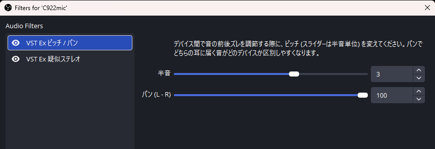
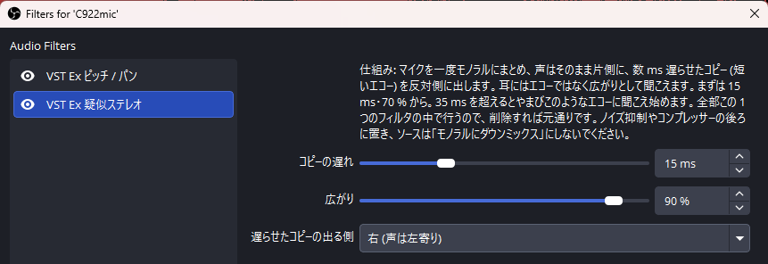
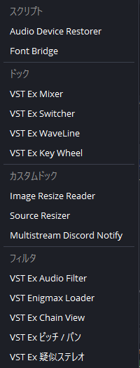
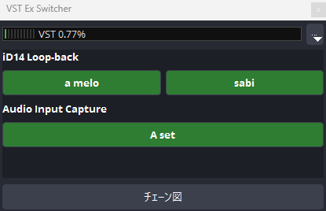
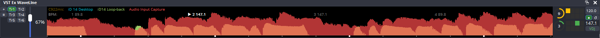
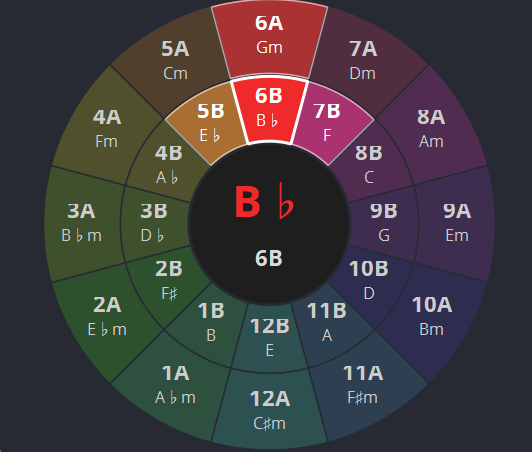

[English](README.md) | [日本語](README.ja.md) | [한국어](README.ko.md) | [Bahasa Indonesia](README.id.md) | [Français](README.fr.md) | **繁體中文**

# VST Ex Audio Filter for OBS

OBS Studio 的擴充音訊濾鏡視窗，具備歌唱直播用的即時 ON/OFF 切換、延遲量測與鏈狀圖，並附帶自有的
**VST2 / VST3** 主機 **VST Enigmax Loader**。「濾鏡 (VST Ex)」視窗與 OBS 內建「濾鏡」視窗處理同一條濾鏡鏈，
兩邊都能操作。

會安裝兩個 OBS 外掛: **VST Ex** (視窗、停駐視窗與內建濾鏡) 與 **VST Enigmax Loader** (VST 主機)。
VST 濾鏡屬於 VST Enigmax Loader，移除它後 OBS 就無法載入這些濾鏡。移除前請先用「移交」(見下方)
將 VST2 濾鏡移到 OBS 內建的 VST 2.x 濾鏡。

- Windows x64，OBS Studio 31 以上 (已在 33.0 測試)
- 製作者: ChromeBread feat. BlackDream · 授權: GPL-2.0

## 安裝

1. 從 [Releases](../../releases) 下載 `OBS-VST-Ex-Audio-Filter-<版本>-windows-x64-setup.exe`。
2. 關閉 OBS 後執行。「完整安裝」安裝全部；「自訂安裝」可選擇:
   - VST Ex Audio Filter (必要):「濾鏡 (VST Ex)」、音高 / 偽立體聲濾鏡、工具 > #cbOBScripts > VST Ex Audio Filter
   - VST Enigmax Loader: VST2 / VST3 外掛
   - VST Ex Chain View、VST Ex Mixer 停駐視窗、VST Ex Switcher 停駐視窗、VST Ex WaveLine 停駐視窗

   VST Ex 的選用部分之後可在 工具 > #cbOBScripts > VST Ex Audio Filter 開關 (重新啟動 OBS 後生效)。
3. 啟動 OBS。第一次啟動時會詢問縮圖、截圖與歷程的儲存位置。

**免安裝版**: `OBS-VST-Ex-Audio-Filter-<版本>-windows-x64-portable.zip`。關閉 OBS 後解壓縮到
`C:\ProgramData\obs-studio\plugins\`，會得到 `OBS-VST-Ex-Audio-Filter` (VST Ex) 與 `vst-enigmax-loader`
(VST Enigmax Loader) 兩個資料夾。不需要的資料夾可以不放。移除時關閉 OBS 並刪除資料夾即可 (請先移交 VST 濾鏡，見下方)。
若要備份後再移除，請執行 `OBS-VST-Ex-Audio-Filter\Safe_Uninstaller\Safe_Uninstaller.bat`。

**解除安裝** (Windows 設定 > 應用程式 > VST Ex Audio Filter for OBS)。解除安裝程式會:
1. 若場景集合仍使用 VST Enigmax Loader 濾鏡就發出警告，讓你先移交
2. 分別詢問是否刪除外掛縮圖、高解析度截圖，以及設定 / 預設 / 歷程 (也可選「全部匯出後再刪除」)
3. 若資料夾中有不是它建立的檔案 (其他檔案、`.bak` / `.org` 等改名的副本)，會列出清單讓你逐一刪除或保留

## VST Ex Audio Filter

**濾鏡 (VST Ex) 視窗** — 在音訊混音器對來源按右鍵 >「濾鏡 (VST Ex)」
- 大型 ON/OFF 按鈕、多選、拖曳排序、複製 (Ctrl+D)、全部刪除、每個濾鏡的備註
- 復原 / 重做，以及重新啟動 OBS 後仍保留的自動儲存紀錄
- 每個濾鏡的延遲與合計，並可一鍵用同步偏移補償
- **預設**: 儲存 / 套用 / 匯出 / 匯入整條濾鏡鏈
- **ON/OFF 組合** (含同步偏移與音量): 唱到一半瞬間切換主歌 → 副歌，也可用快速鍵
- **以四拍測量**: 播放 BPM120 測試曲，跟著拍手 (或把耳機貼在麥克風上) 即可算出同步偏移； 可縮放、附毫秒刻度的波形，方便手動微調

 

*濾鏡 (VST Ex) 視窗 / 濾鏡 (VST Ex) 視窗，多重選取*

 

*歷史記錄 / 以四拍測量 Sync Offset*

**內建濾鏡**
-「VST Ex 移調 / 聲像」: 以半音為單位的音高與聲像，對齊裝置時容易分辨
-「VST Ex 假立體聲」: 不用 DAW 就能讓單聲道麥克風變寬 (哈斯效應)，一個濾鏡即可新增或移除

 

*VST Ex 移調 / 聲像 / VST Ex 假立體聲*

- 工具 > #cbOBScripts > VST Ex Audio Filter: 語言 (EN / JP / KR / ID / FR / TW)、版本、選用部分開關、**偵錯模式**

*工具 > #cbOBScripts*

## VST Enigmax Loader

- VST2 與 VST3，在獨立程序中安全掃描 (手動開始，附預估時間)
- 清單 / 縮圖 / 詳細檢視的瀏覽器，排序、搜尋、我的最愛、HID (隱藏) 標記、備註、最近使用
- 第一次開啟編輯器時自動擷取縮圖，也可一次全部產生；每個濾鏡的個別截圖
- 在編輯器視窗匯出 / 匯入外掛設定
- 縮圖與高解析度截圖分開存放在不同資料夾
- 不同資料夾中的相同外掛與 OBS 一樣視為不同項目，我的最愛、HID、備註與縮圖可逐一設定

*選擇 VST 外掛 (縮圖檢視)*

 

*選擇 VST 外掛 (清單檢視) / 選擇 VST 外掛 (詳細資料檢視)*

## VST Ex Chain View

-「VST Ex Chain View」(工具選單): 從裝置到輸出的所有來源、延遲、音量、側鏈、半圓聲像儀 (可選)、另存為圖片
- 可選擇畫面與儲存圖片的內容: 僅作用中的來源、音軌 1 至 6，以及逐項切換音量、單聲道、平衡、同步偏移、音訊監聽
- 拖曳列可重新排序來源、按右鍵在來源名稱右側寫備註、每 N 個 VST 換行

*VST Ex Chain View*

## VST Ex Mixer

-「VST Ex Mixer」停駐視窗: 在音訊混音器音量表下方，每個來源一欄、每個 VST 一個按鈕

*放置 VST Ex Mixer 與 VST Ex Switcher 停駐視窗的 OBS*

## VST Ex Switcher

-「VST Ex Switcher」停駐視窗: ON/OFF 組合按鈕與 CPU 使用率 (OBS 整體與 VST 部分)

## VST Ex WaveLine

- 將選定來源的波形重疊流動顯示；可從 `≡` 切換一般波形與立體聲 (L 在上、R 在下)

*VST Ex Switcher*
- 由左至右：Tr 按鈕、縮放長條 (顯示 2 到 60 秒)、波形。亮起音軌上會送往直播的來源顯示較深，其他較淡 (僅顯示，不改變路由)
- 拖曳波形的左右邊緣可縮窄或加寬，左右會一起移動
- 右側是節拍顯示：每 16 拍轉一圈的數字圓圈，以及每 8 拍轉一圈的 4x2 橫條。上列依設定的 BPM (預設 120) 走動。`●` 開 / 關，`↺` (或快捷鍵「VST Ex WaveLine: 重設節拍」) 將現在設為第 1 拍
- `≡`: 各來源的圖層順序與不透明度，以及波形樣式

### VirtualDJ 連動

在 工具 > #cbOBScripts > VST Ex Audio Filter 開啟「在 VST Ex WaveLine 中與 VirtualDJ 連動」即可使用 (關閉期間不顯示任何內容，也不等待連線)。VirtualDJ 透過 OS2L 連線，外掛只在本機 (127.0.0.1) 等待連線。

- 下方節拍列：依 VirtualDJ 的節拍與 BPM 走動
- 開啟「顯示 VirtualDJ 4 個唱盤的標籤」後，會在來源名稱下方並排顯示各唱盤曲目的標籤 (預設為註解)，主唱盤加上 ▶。點擊該列可依序切換選擇的標籤
- 準備：WaveLine 的 VDJ 按鈕 > 準備 VirtualDJ。會依序引導 VirtualDJ 的設定、使用的唱盤數量與要顯示的標籤，以及要貼到 VirtualDJ 自訂按鈕的腳本 (每個唱盤一個)。每次啟動 VirtualDJ 時各按一次按鈕 (再按一次即停止)
- VirtualDJ 每秒只傳送約 10 個值，唱盤與標籤越多，顯示更新越慢 (每數秒一次)。收到的內容會一直顯示

*與 VirtualDJ 連動的 VST Ex WaveLine (4 個唱盤的 BPM，主唱盤加上 ▶)*

## VST Ex Key Wheel

- 以「顯示 VST Ex Key Wheel 停駐窗」(開啟 VirtualDJ 連動後可選) 顯示的停駐窗：以五度圈 (Camelot) 顯示 VirtualDJ 主唱盤的調性，並旋轉讓播放中的調性位於最上方。適合銜接的調性 (相鄰與關係調) 也會亮起
- 調性來自 準備 VirtualDJ 所產生的按鈕 1 腳本

*VST Ex Key Wheel*

## 建置

Visual Studio 2022 與 CMake 3.28 以上: `cmake --preset windows-x64`，接著
`cmake --build build_x64 --config RelWithDebInfo`。

VST 是 Steinberg Media Technologies GmbH 的註冊商標。

## 關於更新

本軟體沒有檢查更新或自動更新的功能，今後也沒有實作連網自動更新功能的計畫。需要更新時，請依開發者的連結自行前往發布網站下載: [Releases](../../releases)
